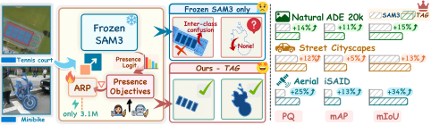

<div align="center">

# ✨ TAG
### Calibrating SAM3 for Universal Image Segmentation without Dense Supervision

**Hao Zhu · Heyu Sun · Shuo Jin · Jiayu Xiao · Feng Dai**

[](https://arxiv.org/abs/2610.14651)

[Overview](#-overview) · [Results](#-results) · [Quick Start](#-quick-start) · [Evaluation](#-evaluation) · [Citation](#-citation)

</div>

Frozen SAM3 baseline evaluation for semantic, instance, and panoptic segmentation. The full TAG implementation and checkpoints will be released after acceptance.

## 📣 Latest News

- 📄 Our paper is now available on [arXiv](https://arxiv.org/abs/2610.14651).

## 💡 Overview

**TAG (Text Anchor re-Grounding)** calibrates SAM3's concept recognition with image-level supervision while keeping the pretrained model frozen. It combines an Anchor Residual Pathway, presence and ranking objectives, and Confidence-Weighted Distillation.

- **Universal segmentation:** Semantic, instance, and panoptic prediction.
- **Image-level supervision:** TAG-I uses human labels; TAG-V uses MLLM-generated labels.
- **Lightweight adaptation:** Only 3.1M trainable parameters.

<p align="center">
  <a href="assets/fig_intro.pdf">
    
  </a>
</p>

## 📊 Results

Validation results from the [paper](https://arxiv.org/abs/2610.14651), in percent.

| Dataset | Method | PQ ↑ | Mask AP ↑ | mIoU ↑ |
|:---|:---|---:|---:|---:|
| ADE20K | Frozen SAM3 | 32.7 | 25.0 | 37.5 |
| ADE20K | TAG-V | 40.8 | 31.5 | 47.0 |
| ADE20K | **TAG-I** | **46.9** | **35.7** | **52.7** |
| Cityscapes | Frozen SAM3 | 50.3 | 36.5 | 66.9 |
| Cityscapes | TAG-V | 61.6 | **41.0** | 78.1 |
| Cityscapes | **TAG-I** | **62.7** | **41.0** | **80.3** |
| iSAID | Frozen SAM3 | 19.2 | 12.2 | 27.6 |
| iSAID | TAG-V | 41.9 | 23.6 | 57.4 |
| iSAID | **TAG-I** | **44.2** | **25.5** | **61.4** |

## 🚀 Quick Start

### 1. Installation

Requires Python 3.12+, PyTorch 2.7+, and CUDA 12.6+; a GPU with bfloat16 support is recommended. Run from the repository root:

```bash
conda create -n tag-baseline python=3.12 -y
conda activate tag-baseline
pip install torch==2.7.1 torchvision==0.22.1 --index-url https://download.pytorch.org/whl/cu126
git clone https://github.com/facebookresearch/sam3.git ../sam3
git -C ../sam3 checkout 0570b3a5be9c4e694f23d85232fb55f4a6f1f7fc
pip install -e ../sam3
pip install -r requirements.txt
```

### 2. Checkpoint

Download [`sam3.pt`](https://huggingface.co/facebook/sam3) to `weights/sam3.pt`.

## 🗂️ Data Preparation

| Dataset | Classes | Preset |
|:---|:---|:---|
| ADE20K | 150 | `configs/sam3_ade20k.json` |
| Cityscapes | 19 | `configs/sam3_cityscapes.json` |
| iSAID | 15 foreground + background | `configs/sam3_isaid.json` |

<details>
<summary><strong>ADE20K</strong></summary>

```text
data/ade20k/
├── images/validation/*.jpg
├── annotations/validation/*.png
└── annotations_instance/validation/*.png  # Instance / panoptic ground truth
```

For instance and panoptic evaluation:

```bash
python tools/prepare_annotations.py --dataset ade20k \
  --data-root data/ade20k --output annotations/ade20k
```

</details>

<details>
<summary><strong>Cityscapes</strong></summary>

```text
data/cityscapes/
├── leftImg8bit/val/<city>/*_leftImg8bit.png
└── gtFine/val/<city>/
    ├── *_gtFine_labelTrainIds.png  # Or *_gtFine_labelIds.png
    └── *_gtFine_instanceIds.png    # Instance / panoptic ground truth
```

For instance and panoptic evaluation:

```bash
python tools/prepare_annotations.py --dataset cityscapes \
  --data-root data/cityscapes --output annotations/cityscapes
```

</details>

<details>
<summary><strong>iSAID</strong></summary>

Prepare 896×896 validation tiles with stride 512 from RGB images and `*_instance_color_RGB.png` semantic masks:

```bash
python tools/prepare_isaid.py \
  --images data/isaid_original/images/val \
  --semantic data/isaid_original/semantic/val \
  --instances data/isaid_original/instances_val.json \
  --output data/isaid
```

`--instances` takes the original-resolution COCO polygon JSON; omit it for semantic-only evaluation.

```text
data/isaid/
├── img_dir/val/*.png
├── ann_dir/val/*_instance_color_RGB.png
└── annotations/
    ├── iSAID_val_instance.json
    ├── iSAID_val_panoptic.json
    └── iSAID_val_panoptic/*.png
```

Convert the tiled annotations:

```bash
python tools/prepare_annotations.py --dataset isaid \
  --data-root data/isaid --output annotations/isaid
```

For existing tiled annotations, use `--instance-json`, `--panoptic-json`, and `--panoptic-dir`; image names must match `img_dir/val`.

</details>

The converters write:

```text
annotations/<dataset>/
├── instances.json
└── panoptic/
    ├── segments.json
    └── <image-key>.png
```

## 🧪 Evaluation

Choose `--dataset ade20k`, `cityscapes`, or `isaid` and the corresponding data root. ADE20K examples:

```bash
# Semantic segmentation: mIoU
python evaluate.py --dataset ade20k --task semantic \
  --backbone weights/sam3.pt --data-root data/ade20k \
  --output outputs/sam3_ade20k_semantic

# Instance segmentation: COCO mask AP
python evaluate.py --dataset ade20k --task instance \
  --backbone weights/sam3.pt --data-root data/ade20k \
  --annotations annotations/ade20k --output outputs/sam3_ade20k_instance

# Panoptic segmentation: PQ, SQ, RQ
python evaluate.py --dataset ade20k --task panoptic \
  --backbone weights/sam3.pt --data-root data/ade20k \
  --annotations annotations/ade20k --output outputs/sam3_ade20k_panoptic
```

| Option | Purpose |
|:---|:---|
| `--save-predictions` | Save label maps and masks |
| `--prompt-batch-size 1` | Reduce GPU memory use |
| `--config path/to/preset.json` | Use a custom evaluation preset |

Metrics are saved to `<output>/metrics.json`; optional predictions go to `<output>/predictions/`.

## 📝 Citation

Please cite our work if you find it helpful to your research.

```bibtex
@misc{zhu2026tag,
  title         = {{TAG}: Calibrating {SAM3} for Universal Image Segmentation without Dense Supervision},
  author        = {Zhu, Hao and Sun, Heyu and Jin, Shuo and Xiao, Jiayu and Dai, Feng},
  year          = {2026},
  eprint        = {2610.14651},
  archivePrefix = {arXiv},
  primaryClass  = {cs.CV},
  url           = {https://arxiv.org/abs/2610.14651}
}
```

## 🙏 Acknowledgments

We thank the authors of [SAM3](https://github.com/facebookresearch/sam3) and [COCO API](https://github.com/cocodataset/cocoapi).

[License](LICENSE)
